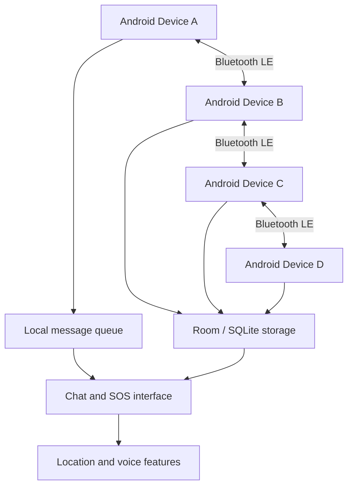

MeshLink
Offline Bluetooth Mesh Emergency Communication for Android
Communication that can keep moving when internet connectivity is unavailable.

Repository · [Physical Testing Guide](docs/testing.md)

1. Overview
During floods, earthquakes, landslides, and other emergencies, mobile networks and internet access may become unavailable or overloaded. People nearby may still have working phones, but lack a dependable way to pass messages between separated groups.

MeshLink is a native Android prototype exploring offline, device-to-device emergency communication. It uses Bluetooth Low Energy (BLE) for peer discovery and data transfer, with local storage and routing designed to support communication through nearby relay devices.

The offline communication path is designed to work without Wi-Fi, mobile data, or a cloud relay.
Important: MeshLink is a prototype, not a certified emergency-response system. It must not be used as the sole way to contact emergency services. Real-world performance depends on device compatibility, BLE range, Android background restrictions, and physical testing.

2. The Problem
- Connectivity can fail: disasters can damage or overload communication infrastructure.
- People may be close but disconnected: phones outside direct radio range cannot communicate directly.
- Emergency information is time-sensitive: SOS messages, location details, and voice reports can help people communicate urgency.
- Internet-dependent tools may be unavailable: a local communication path can be useful when data services cannot be reached.
3. The MeshLink Approach
MeshLink explores a local communication network in which Android phones discover peers and exchange data over BLE. When devices cannot reach one another directly, an intermediate phone can potentially relay eligible messages.

The application brings together:
- peer discovery and app-level identity exchange;
- message delivery and relay through available peers;
- local persistence and retry behavior;
- SOS messages with available sender and location information;
- voice-message transfer and playback;
- local Android location/GNSS capabilities.
These capabilities and their reliability should be evaluated against the physical test plan before being described as production-ready.
4. Key Features
Feature	Purpose
Offline BLE communication	Uses Bluetooth Low Energy for the intended device-to-device communication path.
Peer discovery	Finds nearby devices participating in Mesh Mode.
Multi-hop relay	Supports forwarding through intermediate devices when a direct path is unavailable.
Store and forward	Keeps eligible messages available for retry when a peer becomes reachable again.
SOS messaging	Shares an emergency event with available identity and location information.
Location support	Uses local Android location/GNSS capabilities for location features.
Voice messages	Supports local audio, transfer in chunks, reassembly, and playback.
Local persistence	Uses Room/SQLite for on-device data.
Local security components	Uses Android Keystore as part of the security design.
Message/voice association	Associates voice assets with message IDs and keeps playback independent per asset.
Tolerant SOS/voice ordering	An SOS card can resolve a stored voice asset even if the voice transfer finishes first.

5. System Architecture

Message flow
1. Users enable Mesh Mode and grant the required Android permissions.
2. Devices discover nearby peers over BLE.
3. The app exchanges MeshLink identity metadata through its HELLO flow.
4. Messages are sent directly when possible or forwarded through available relay devices.
5. Eligible messages can be queued for retry when a destination is temporarily unavailable.
6. SOS, location, and voice information are handled through the app's local communication path.
This diagram represents the intended design, not proof that every route or topology has passed physical validation.
6. Technology Stack
Layer	Technology
Platform	Android
Programming language	Kotlin
UI	Jetpack Compose, Material 3
Device communication	Bluetooth Low Energy (BLE), GATT
Local database	Room / SQLite
Dependency injection	Hilt
Code generation	KSP
Asynchronous work	Kotlin Coroutines
Local security component	Android Keystore
Location	Android location APIs / device GNSS
Audio	Local audio recording, BLE chunk transfer, and playback
Build system	Gradle Wrapper

7. Requirements
Before building the project, prepare:
- Android Studio compatible with the project's Gradle and Android Gradle Plugin configuration;
- JDK 17, if required by the project configuration;
- the Android SDK platforms and build tools specified by the project;
- at least two physical Android phones for meaningful BLE testing;
- Bluetooth Low Energy support on each test phone.
An emulator may be useful for UI development, but it cannot replace real devices for validating Bluetooth discovery, GATT behavior, multi-hop routing, or background execution.
8. Setup and Build
Step 1 — Clone the repository
git clone https://github.com/KUMARI-SONALIUPADHYAY/MeshLink.git
cd MeshLink
Step 2 — Open the Android project
Open the directory containing settings.gradle.kts in Android Studio. Allow Gradle sync to finish and install any SDK components requested by the IDE.
Step 3 — Build the debug APK
On macOS/Linux:
./gradlew assembleDebug
On Windows:
gradlew.bat assembleDebug
Step 4 — Install and run
Run the app configuration on a connected Android phone from Android Studio. Grant the runtime permissions required for the features you intend to test.
If the build fails, check the project's Gradle wrapper, Android Gradle Plugin, JDK, and installed SDK versions. The exact build result depends on the local development environment.

9. Android Permissions
Depending on Android version and feature usage, MeshLink may request permissions for:
- Bluetooth scan, connect, and advertise — peer discovery and BLE communication;
- Location — location-related features;
- Microphone — voice recording;
- Notifications — supported notification behavior;
- Vibration — local alert feedback;
- Foreground services — continued operation where applicable and permitted by Android.
Permission names and runtime behavior differ across Android versions. Grant permissions only when needed, and review system prompts carefully.
10. Demonstrating the Offline Path
Use physical Android devices for the demonstration.
1. Install the same build on every test phone.
2. Grant the permissions required by the test.
3. Turn Wi-Fi off and mobile data off on every phone.
4. Keep Bluetooth enabled and turn on Mesh Mode.
5. Confirm that nearby peers are discovered.
6. Test text messages, relay behavior, SOS, location, and voice transfer.
7. Record the device models, Android versions, test conditions, and results.
The intended offline path uses BLE, local persistence, local GNSS/location capability, and local audio. Internet access is not required for that communication path. Initial setup, downloading dependencies, or installing the application may still require internet access.
11. Physical Validation Plan
Follow [`docs/testing.md`](docs/testing.md) for the detailed test procedures.
Test	Setup	What to check
Direct communication	Device A ↔ Device B	Discovery, session setup, message delivery, acknowledgement, reconnect
Three-device relay	A — B — C; A and C out of direct range	Forwarding, hop/TTL behavior, duplicate handling
Four-device route	A — B — C — D	Delivery through intermediate peers
Offline operation	Wi-Fi and mobile data disabled	BLE communication continues without internet
Link recovery	Disconnect and reconnect a peer	Queued messages retry as designed
Duplicate packet	Submit the same packet again	No duplicate application-level delivery
Voice transfer	Send a short voice message	Metadata, chunk transfer, reassembly, playback
SOS event	Trigger an SOS	Alert behavior, identity/location details, relay
Background behavior	Background app or turn screen off	Behavior within Android OS and device-vendor limits

Testing status: A test plan is not the same as a passed test. Report a scenario as successful only after reproducing it and verifying the result on physical Android hardware.
12. Reliability and Identity Details
- A profile name is MeshLink identity metadata carried through the authenticated HELLO flow; it is not the handset's Bluetooth name.
- A profile avatar is local UI metadata.
- Voice assets are stored per message ID, and each asset has independent playback.
- SOS/voice arrival ordering is tolerant: when voice transfer finishes before SOS metadata arrives, the SOS card can resolve the stored voice asset when the relevant data becomes available.
- The offline path does not add simulated nodes, fabricated coordinates or distances, or a cloud relay.
13. Project Structure
MeshLink/
├── app/                 # Android application module
├── docs/
│   └── testing.md       # Physical BLE testing guide
├── gradle/
│   └── wrapper/         # Gradle wrapper files
├── build.gradle.kts
├── settings.gradle.kts
└── README.md
This is a representative layout. Confirm file and directory names against the current repository.
14. Roadmap
- [ ] Validate direct communication between two physical phones.
- [ ] Validate three-device and four-device relay scenarios.
- [ ] Test queueing and retry behavior after link loss.
- [ ] Verify SOS delivery and location handling.
- [ ] Verify voice chunk transfer, reassembly, and playback.
- [ ] Test background behavior across Android versions and device manufacturers.
- [ ] Publish reproducible test results, including device models and Android versions.
15. Contributing and Bug Reports
Feedback and contributions are welcome. When reporting a problem, include:
- Android version and phone model(s);
- number of devices and approximate test arrangement;
- steps to reproduce the issue;
- expected versus observed behavior;
- relevant logs with personal information removed.
Do not post private emergency recordings, personal location data, phone numbers, or other sensitive information in public issues.
16. Safety and License
Safety
MeshLink is an experimental prototype. BLE range and reliability vary with device hardware, environment, interference, operating-system restrictions, and battery settings. Do not depend on MeshLink as the only way to seek emergency assistance.
License
A license was not confirmed from the supplied project information. Until a license is added to the repository, others should not assume that reuse, modification, or redistribution is permitted. Add a LICENSE file if you intend to publish MeshLink under a particular open-source license.

MeshLink — exploring resilient, local communication when connectivity is disrupted.

View MeshLink on GitHub

