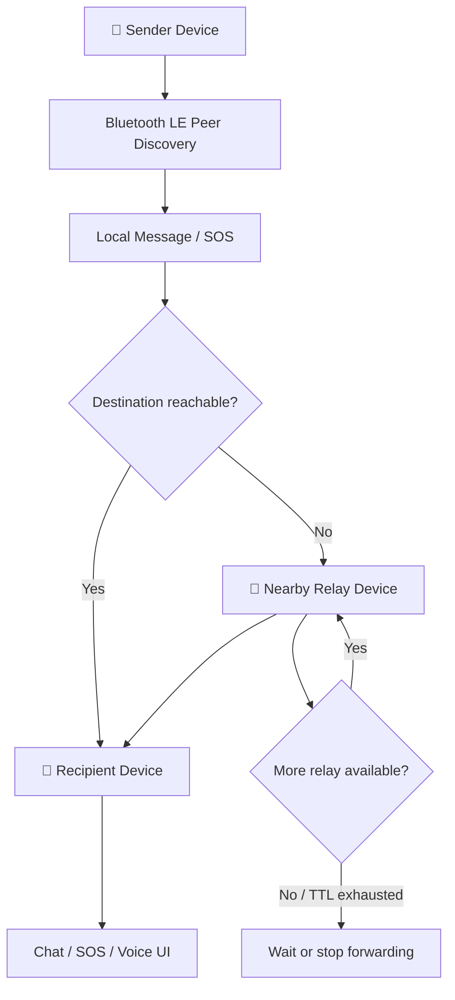

<h1><strong>🌊 MeshLink</strong></h1>

<h3><strong>Offline Bluetooth Mesh Emergency Communication</strong></h3>

<strong>A resilient, offline-first Android communication prototype for emergencies.</strong>

  
  
  
  

  <a href="https://github.com/KUMARI-SONALIUPADHYAY/MeshLink"><strong>Explore the Repository</strong></a>
  &nbsp; • &nbsp;
  <a href="docs/testing.md"><strong>Physical Testing Guide</strong></a>

<h2><strong>🚨 Why MeshLink?</strong></h2>

During floods, earthquakes, landslides, and other emergencies, internet access and mobile networks can become unavailable or overloaded. People may still have phones nearby, but no reliable way to pass urgent information between separated groups.

<strong>MeshLink explores a local alternative:</strong> nearby Android devices discover and communicate with one another using Bluetooth Low Energy (BLE). Compatible devices can also relay eligible messages, helping information travel beyond a single direct connection.
Project status: MeshLink is an Android prototype. It is not a certified emergency service and must not be the only method used to request emergency assistance. Real-world reliability must be established through testing on physical devices.

<h2><strong>✨ Key Features</strong></h2>

<table>
  <tr>
    <td width="50%">
      <h3><strong>📡 Offline BLE Communication</strong></h3>
      Discover nearby participating devices and exchange data without Wi-Fi or mobile data on the intended offline path.
    </td>
    <td width="50%">
      <h3><strong>🔁 Multi-Hop Relay</strong></h3>
      Forward eligible messages through intermediate devices when a direct connection is unavailable.
    </td>
  </tr>
  <tr>
    <td width="50%">
      <h3><strong>🆘 SOS Messaging</strong></h3>
      Share emergency events with available sender and location information.
    </td>
    <td width="50%">
      <h3><strong>📍 Local Location Support</strong></h3>
      Use Android location/GNSS capabilities for location-related features.
    </td>
  </tr>
  <tr>
    <td width="50%">
      <h3><strong>🎙️ Voice Messages</strong></h3>
      Support local audio, chunked transfer, reassembly, and playback.
    </td>
    <td width="50%">
      <h3><strong>💾 Local Persistence</strong></h3>
      Use Room/SQLite and local message-handling logic for stored data and supported retry behavior.
    </td>
  </tr>
</table>

<h2><strong>🧭 How It Works</strong></h2>

1. Discover: Participating phones find nearby peers over BLE.
2. Exchange: Devices establish an app-level session and exchange MeshLink identity metadata.
3. Relay: Eligible messages can be forwarded through available peers.
4. Store and retry: Supported message-handling logic can retain eligible data for retry.
5. Receive: The recipient can view available message, SOS, location, or voice information.
This diagram explains the intended communication flow. It does not mean every route has passed physical validation.
<h2><strong>🧰 Technology Stack</strong></h2>

Component	Technology
Android app	Kotlin
User interface	Jetpack Compose, Material 3
Wireless communication	Bluetooth Low Energy (BLE), GATT
Local database	Room / SQLite
Dependency injection	Hilt
Code generation	KSP
Asynchronous operations	Kotlin Coroutines
Local security component	Android Keystore
Location	Android location APIs / device GNSS
Build system	Gradle Wrapper

<h2><strong>🚀 Getting Started</strong></h2>

<h3><strong>Prerequisites</strong></h3>

- Android Studio compatible with the project's Gradle configuration
- JDK version required by the project (JDK 17 if configured)
- Android SDK platforms and build tools required by the project
- At least two physical Android devices for meaningful BLE testing
<h3><strong>1. Clone the Repository</strong></h3>

git clone https://github.com/KUMARI-SONALIUPADHYAY/MeshLink.git
cd MeshLink
<h3><strong>2. Open in Android Studio</strong></h3>

Open the directory containing settings.gradle.kts, allow Gradle sync to complete, and install any required SDK components.
<h3><strong>3. Build the Debug App</strong></h3>

Windows
gradlew.bat assembleDebug
macOS / Linux
./gradlew assembleDebug
<h3><strong>4. Run on a Device</strong></h3>

Launch the app configuration from Android Studio and grant the permissions needed for the features you want to test.
<h2><strong>📴 Offline Demo</strong></h2>

To test the intended offline path:
1. Install the same app build on each physical Android phone.
2. Grant the runtime permissions required for your test.
3. Turn Wi-Fi off and mobile data off on every phone.
4. Keep Bluetooth enabled and turn on Mesh Mode.
5. Confirm that participating devices discover one another.
6. Test text messaging, relay, SOS, location, and voice features.
7. Record results and any failures for each scenario.
The offline communication path is intended to use BLE, local persistence, local location capability, and local audio. Initial setup or downloading build dependencies may still require internet access.
<h2><strong>🧪 Physical Testing</strong></h2>

Use [`docs/testing.md`](docs/testing.md) for the detailed test procedures.
Test	What to verify
Two-device connection	Peer discovery, session, message delivery, acknowledgement and reconnect
Three-device relay	Forwarding between devices that cannot communicate directly
Four-device route	Multi-hop delivery across intermediate peers
Offline operation	Communication with Wi-Fi and mobile data disabled
Link recovery	Supported retry behavior after a connection returns
Duplicate handling	Duplicate packets do not cause repeated application-level delivery
Voice transfer	Metadata, chunks, reassembly and playback
SOS handling	Alert behavior and available sender/location details
Background behavior	Operation within Android OS and device-vendor limits

Testing note: Only mark a scenario as passed after it has been run and verified on real Android hardware.
<h2><strong>🛡️ Reliability Notes</strong></h2>

- A profile name is MeshLink identity metadata carried through the authenticated HELLO flow; it is not the handset's Bluetooth name.
- A profile avatar is local UI metadata.
- Voice assets are associated with message IDs, and playback is independent per asset.
- SOS/voice arrival order is handled so an SOS card can resolve the associated stored voice asset when it becomes available.
- The offline path does not add simulated nodes, fabricated coordinates or distances, or a cloud relay.
<h2><strong>🗺️ Roadmap</strong></h2>

- [ ] Validate two-device BLE messaging.
- [ ] Test three-device and four-device relay scenarios.
- [ ] Verify retry behavior after connection loss.
- [ ] Validate SOS and location handling.
- [ ] Validate voice transfer and playback.
- [ ] Test background behavior across Android versions and device manufacturers.
- [ ] Publish reproducible physical-device test results.
<h2><strong>🤝 Contributing</strong></h2>

Found an issue or have an improvement? Include the Android version, device model(s), number of devices, steps to reproduce, and relevant logs with personal information removed.

Please do not publish private emergency recordings, personal location data, or phone numbers in public issues.
<h2><strong>⚠️ Safety &amp; License</strong></h2>

MeshLink is an experimental prototype. Bluetooth range, device compatibility, interference, battery settings, and Android background restrictions can affect reliability. Do not depend on it as the sole way to seek emergency assistance.

A license was not confirmed from the supplied project information. Until a LICENSE file is added, others should not assume reuse or redistribution is permitted.

<strong>MeshLink — exploring resilient communication when connectivity is disrupted.</strong>

<a href="https://github.com/KUMARI-SONALIUPADHYAY/MeshLink"><strong>⭐ View the GitHub Repository</strong></a>

